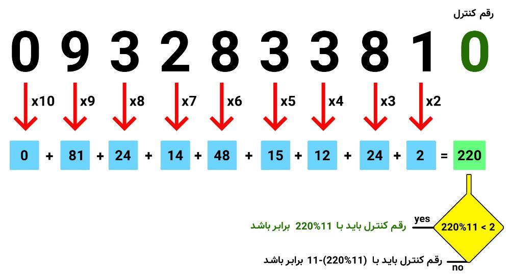

# NationalIdValidator

## فارسی
این پروژه برای اعتبارسنجی کد ملی ایرانی نوشته شده است.  
کد شامل کلاس‌های مدل، کنترل داده و کلاس اصلی برای گرفتن ورودی کاربر و بررسی صحت کد ملی می‌باشد.

## English
This project is designed to validate Iranian National ID numbers.  
The code contains model classes, data controller classes, and a main class to take user input and verify the National ID.

## الگوی کد ملی / National ID Pattern

